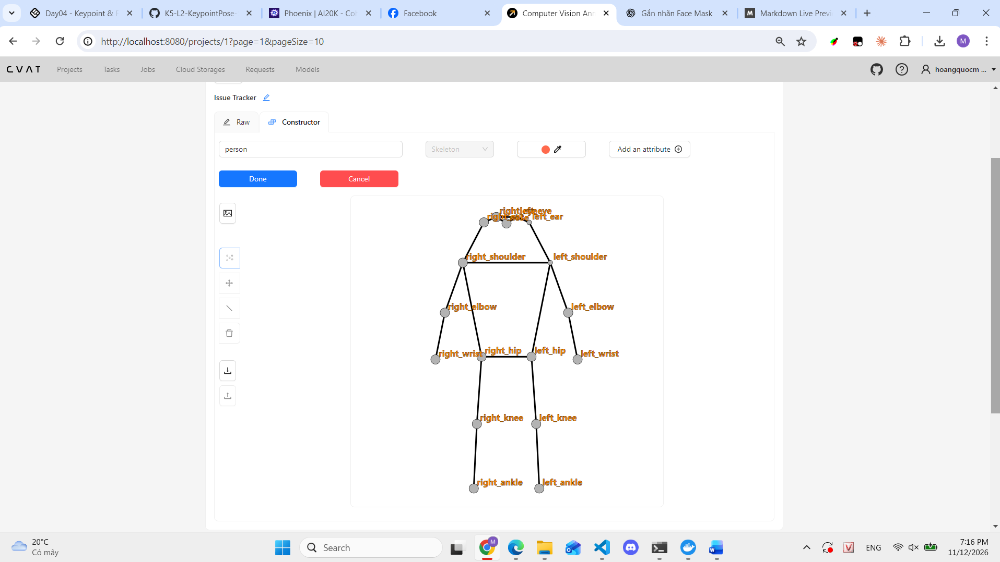
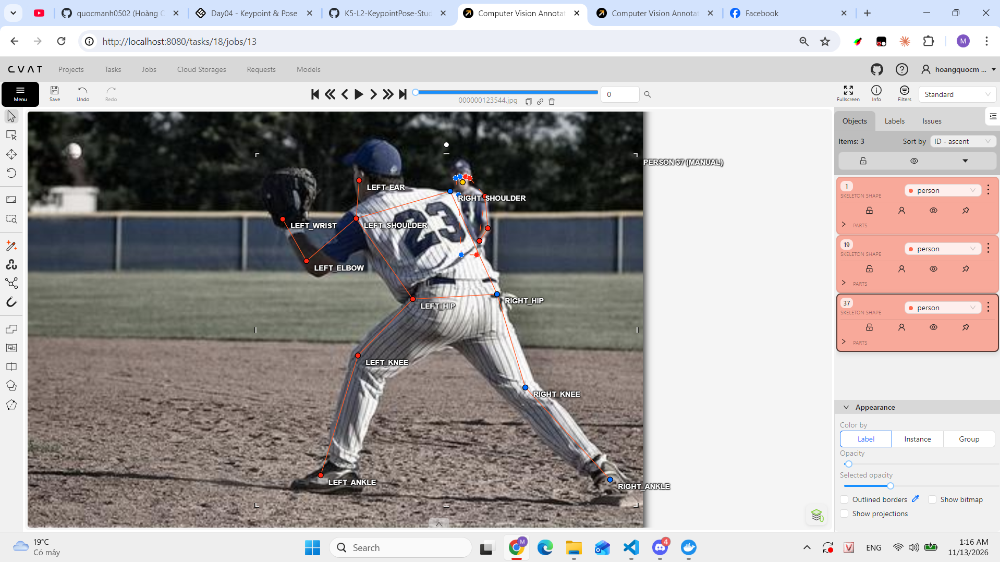
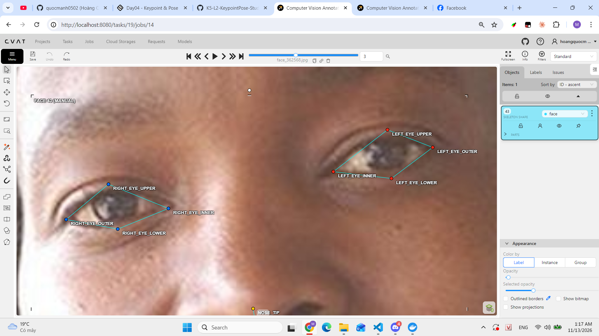
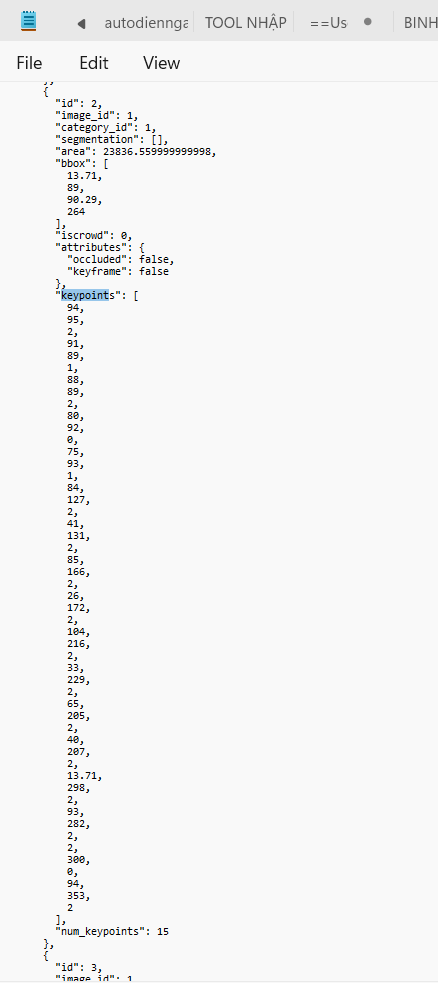

# Báo cáo cá nhân — HoangQuocManh-03219

Dữ liệu: 12 ảnh người COCO val2017 (Lin et al., 2014) và 8 ảnh chân dung Wikimedia Commons, chỉ dùng trong lớp.

## 0. Thông tin học viên

- Họ tên: Hoàng Quốc Mạnh
- MSSV: 03219
- Email: hoangquocmanh2004@gmail.com
- Link repository: https://github.com/quocmanh0502/K5-L2A-DAY04-HoangQuocManh-03219-KeypointPose
- Phiên bản CVAT (Help → About): 2.82.0
- Máy: hệ điều hành Windows 11 · RAM 16 GB · chạy CVAT chế độ đầy đủ
- Bộ ảnh (`src/exports/assignment.json` do `lab.py setup` tạo): có
- Giờ bắt đầu: 16:40
- Giờ kết thúc: 18:30

## 1. Kiểm tra label (CP0)

| Label | Kiểu | Số điểm | Tên điểm đúng bảng của lab? | Đúng thứ tự? | Số cạnh |
|---|---|---:|---|---|---:|
| `person` | skeleton | 17 | Có | Có (`nose` → `right_ankle`) | 19 |
| `face` | skeleton | 13 | Có | Có (`left_eye_outer` → `lip_lower`) | 13 |

Mẫu `person` dựng theo người quay mặt về camera (các điểm `left_*` nằm bên phải khung mẫu)? Có

Cách đổi cờ `occluded` / `outside` cho **một điểm** trên phiên bản CVAT này (một câu):

Trong danh sách Objects, mở mục **Parts** của skeleton, rồi bấm biểu tượng `occluded` (phím `Q`) hoặc `outside` (phím `O`) ngay trên dòng của điểm đó. Không dùng `hidden` (phím `H`), vì cờ này không được lưu lên server.

## 2. Số lượng đã gán và thời gian (CP1, CP2)

| Nhóm ảnh | Số ảnh | Số skeleton đã gán | Số người dưới 60 px (không gán) | Số poster / gương / màn hình bỏ qua | Thời gian (phút) |
|---|---:|---:|---:|---:|---:|
| `easy` | 5 | 5 | 0 | 0 | 25 |
| `occluded` | 3 | 6 | 0 | 0 | 20 |
| `back` | 2 | 5 | 0 | 0 | 20 |
| `small` | 1 | 0 | 5 | 0 | 5 |
| `crowd` | 1 | 3 | 4 | 0 | 10 |
| `faces` | 8 | 8 | — | 0 | 20 |
| **Tổng** | **20** | **27** | **9** | **0** | **100** |

CP1 (80 phút) chia cho 5 nhóm ảnh người, CP2 (20 phút) là ảnh mặt. 10 phút còn lại là CP3.

Nhóm ảnh theo `assignment.json`:

- `easy`: 201702, 240340, 295358, 308257, 343057. Mỗi ảnh 1 người.
- `occluded`: 324953 (2 đầu bếp), 360811 (2 người ngồi sau bàn), 469061 (người lớn và em bé trượt tuyết).
- `back`: 123544 (3 người), 359340 (người áo xám và người áo đen phía sau).
- `small`: 323705. Đồng hồ ở nhà ga, khoảng 5 người đứng trên ban công phía sau, tất cả đều dưới 60 px nên không gán.
- `crowd`: 130816. Gán 3 người (2 cầu thủ phía trước và cầu thủ số 36 ở xa). Bỏ 4 người dưới 60 px.

Số skeleton `person` trên CVAT theo ảnh, sau khi sửa ở CP3:

| Ảnh | 123544 | 130816 | 201702 | 240340 | 295358 | 308257 | 323705 | 324953 | 343057 | 359340 | 360811 | 469061 | Tổng |
|---|---:|---:|---:|---:|---:|---:|---:|---:|---:|---:|---:|---:|---:|
| Số skeleton | 3 | 3 | 1 | 1 | 1 | 1 | 0 | 2 | 1 | 2 | 2 | 2 | 19 |

Ảnh 130816 bỏ 4 người dưới 60 px. Ảnh 359340 thêm 1 người phía sau (xem mục 4).

- Số ảnh người đã xong ở mốc phút 105: 7 / 10
- Thời gian thực tế (phút): CP1 80 · CP2 20 · CP3 10
- Ảnh tốn thời gian nhất là ảnh nào, vì sao?

  123544. Ảnh có 3 người với 3 hướng khác nhau. Người chạy mặt nghiêng nhưng thân xoay 3/4 về camera, nên hai đùi bắt chéo thật mà không phải lỗi đổi trái/phải. Cầu thủ số 23 quay lưng và xoay sang trái ảnh. Người phía sau bị che gần hết thân dưới.

## 3. Bảng ca khó (CP1, CP2)

Mỗi điểm bạn phân vân một dòng, nhất là phân vân giữa `v = 1` và `v = 0`, hoặc không chắc hướng người.

| Ảnh | Người / mặt | Điểm | Cờ đã chọn | Phân vân giữa | Lý do chọn |
|---|---|---|---:|---|---|
| 123544 | Người chạy (mặt nghiêng, nhìn sang phải ảnh) | `left_eye` | 1 | `v = 1` / `v = 0` | Mặt nghiêng hẳn, mắt xa bị sống mũi che. Vị trí đoán chắc từ mắt gần và chóp mũi |
| 123544 | Người chạy | `right_ear` | 1 | `v = 2` / `v = 1` | Tai bị miếng che tai của mũ bảo hiểm che, nhưng lỗ tai trên mũ cho biết vị trí chắc chắn |
| 123544 | Người chạy | hông, hai gối | 2 | không chắc hướng thân | Hai đùi bắt chéo. Đã kiểm theo tay: tay phải vung ra sau thì chân phải bước lên trước. Đùi bắt chéo là do thân xoay 3/4, không phải `lr_swap` |
| 123544 | Số 23 (quay lưng, xoay sang trái ảnh) | `nose`, `left_eye`, `right_eye` | 0 | `v = 1` / `v = 0` | Không thấy mặt. Ba người đoán sẽ ra ba điểm tản mát |
| 123544 | Số 23 | `right_elbow`, `right_wrist` | 0 | `v = 1` / `v = 0` | Tay phải bị thân che hoàn toàn, không có đoạn chi nào lộ ra để ước lượng |
| 123544 | Người áo xanh phía sau | `left_hip`, `right_hip` | 1 | `v = 1` / `v = 0` | Bị số 23 che. Ước lượng từ bàn tay chống hông và độ rộng vai |
| 123544 | Người áo xanh phía sau | có gán hay không | gán | gán / bỏ qua | Chỉ lộ đầu và vai, nhưng chiều cao ước lượng trên 60 px, nên gán theo luật nhóm `crowd` |
| 359340 | Người áo đen phía sau, mép phải | `left_eye`, `left_ear`, `left_shoulder`, `left_elbow` | 0 | `v = 1` / `v = 0` | Nửa trái của người nằm ngoài khung ảnh, nên là `outside`, không kéo về mép |
| 483667 | Mặt nam đội mũ | `left_eye_outer` | 1 | `v = 1` / `v = 0` | Bị tóc mái che, nhưng vị trí suy ra chắc từ khóe trong và độ dài mắt phải |

## 4. Bảng tự review (CP3)

Đi từ ảnh cuối về ảnh đầu. 5 ảnh người (ít nhất 2 ảnh `back` hoặc `crowd`) và 3 ảnh mặt. Ít nhất 8 dòng, kể cả dòng `ok`. Ghi lỗi trước, sửa sau.

Mã lỗi dùng đúng một trong: `lr_swap`, `vis_flag`, `position`, `missing`, `extra`, `ok`.

Ảnh người đã chọn: 469061, 360811, 359340 (`back`), 130816 (`crowd`), 123544 (`back`). Ảnh mặt đã chọn: 559185, 504911, 483667.

| Ảnh | Người / mặt | Điểm | Mã lỗi | Ghi chú | Đã sửa? |
|---|---|---|---|---|---|
| 469061 | Người lớn áo trắng: nghiêng, nhìn sang phải ảnh, thân 3/4 về camera | `left_eye`, `right_eye` | `vis_flag` | Đeo kính râm tối nhưng để `v = 2`. Đã đổi thành `occluded` (`v = 1`) | Rồi |
| 469061 | Người lớn áo trắng | `right_knee`, `right_ankle` | `vis_flag` | Chân phải bị em bé che hẳn nhưng để `v = 2`. Đã đổi thành `occluded` (`v = 1`), vị trí suy từ chân trái đứng song song | Rồi |
| 469061 | Em bé mũ đỏ: quay lưng 3/4, nhìn sang phải ảnh | `left_ear` | `vis_flag` | Tai trái ở phía xa, bị đầu và mũ che nhưng để `v = 2`. Đã đổi thành `outside` (`v = 0`) | Rồi |
| 469061 | Em bé mũ đỏ | các điểm còn lại | `ok` | Bên phải gần camera, tay phải là tay cầm gậy thấp hơn. Chân không bắt chéo | — |
| 360811 | Hai người ngồi, quay mặt về camera | toàn bộ | `ok` | `left_*` nằm bên phải ảnh. Hông `occluded` sau bàn, chân `outside`, khuỷu ngoài khung `outside`, đều đúng | — |
| 359340 | Người áo xám, quay lưng | toàn bộ | `ok` | `left_*` nằm bên trái ảnh. Mặt `outside`, `right_wrist` ngoài khung `outside`, đều đúng | — |
| 359340 | Người áo đen phía sau, góc trên bên phải | — | `missing` | Lộ đầu, vai và tay, cao ước lượng trên 60 px. Đã thêm skeleton: nửa trái ngoài khung và thân dưới bị che để `outside` | Rồi |
| 130816 | Hai cầu thủ phía trước, quay mặt về camera | toàn bộ | `ok` | `left_*` nằm bên phải ảnh. Hông và chân của người phía sau bị người trước che, để `outside`, đúng | — |
| 130816 | Cầu thủ số 5 ở xa, quay lưng | — | `extra` | Cao khoảng 53 px, dưới 60 px. Đã xóa và đếm vào mục 2 | Rồi |
| 130816 | Hai người ở giữa sân, xa | — | `extra` | Cao khoảng 35 px, dưới 60 px. Đã xóa | Rồi |
| 130816 | Người ở xa bên phải | — | `extra` | Cao khoảng 45 px, dưới 60 px. Đã xóa | Rồi |
| 123544 | Số 23: quay lưng, xoay sang trái ảnh | `right_elbow`, `right_wrist` | `vis_flag` | Bản nháp đặt hai điểm này lên trời với `v = 2`. Tay phải bị thân che, đã để `outside` | Rồi |
| 123544 | Người chạy: nghiêng, nhìn sang phải ảnh | `nose`, `eye`, `ear` | `position` | Bản nháp đặt các điểm đầu ở x khoảng 212–267, lệch khoảng 150 px so với đầu thật | Rồi |
| 123544 | Người chạy | `left_ankle` | `vis_flag` | Bản nháp kéo điểm về mép ảnh (1, 280) với `v = 2`. Đã để `outside` | Rồi |
| 123544 | Người áo xanh phía sau số 23 | — | `missing` | Cao trên 60 px nhưng bản nháp không gán. Đã thêm | Rồi |
| face_559185 | Nam áo hoodie, quay mặt về camera | `lip_upper` | `position` | Đặt ở khe giữa hai môi. Đã dời lên mép ngoài môi trên, khoảng 5 px | Rồi |
| face_559185 | Nam áo hoodie | `nose_tip` | `position` | Đặt thấp, gần chân mũi. Đã dời lên chóp mũi, khoảng 10 px | Rồi |
| face_559185 | Nam áo hoodie | 11 điểm còn lại | `ok` | Mắt và khóe miệng đúng chỗ | — |
| face_504911 | Nam đeo kính, quay mặt về camera | `nose_tip` | `position` | Đặt lệch về cánh mũi phải. Đã dời sang chóp mũi, khoảng 18 px | Rồi |
| face_504911 | Nam đeo kính | 12 điểm còn lại | `ok` | Kính trong nên mắt để `v = 2` là đúng | — |
| face_483667 | Nam đội mũ, quay mặt về camera | `left_eye_upper` | `vis_flag` | Mí trên bị tóc mái che nhưng để `v = 2`. Đã đổi thành `occluded` (`v = 1`) | Rồi |
| face_483667 | Nam đội mũ | `lip_upper` | `position` | Đặt ở khe môi. Đã dời lên mép ngoài môi trên, khoảng 7 px | Rồi |
| face_483667 | Nam đội mũ | `left_eye_outer` và các điểm còn lại | `ok` | Khóe ngoài bị tóc che, đã để `occluded`, đúng | — |

Tổng hợp số lỗi theo mã:

| `lr_swap` | `vis_flag` | `position` | `missing` | `extra` | `ok` |
|---:|---:|---:|---:|---:|---:|
| 0 | 6 | 5 | 2 | 3 | 7 |

Không có lỗi `lr_swap`. Kiểm theo hướng người: cả 5 ảnh người và 3 ảnh mặt đều đặt `left_*` đúng phía. Hai đùi bắt chéo của người chạy (123544) là tư thế thật, đã ghi ở mục 3.

Điểm còn phân vân giữa `v = 1` và `v = 0` (ghi cả hai lựa chọn và lý do chọn):

- 469061, em bé mũ đỏ, `left_ear`: chọn `v = 0` thay vì `v = 1`. Tai xa bị cả đầu và mũ che, không có mốc nào để ước lượng chắc.
- 469061, người lớn áo trắng, `right_knee` và `right_ankle`: chọn `v = 1` thay vì `v = 0`. Chân trái thấy rõ và đứng song song, nên suy được theo đối xứng.
- 123544, người áo xanh, hai hông: chọn `v = 1` thay vì `v = 0`, vì có bàn tay chống hông làm mốc.

## 5. Kiểm file xuất và kết quả tự kiểm (CP4)

Tự kiểm tay trong file JSON:

| File | Người / mặt kiểm (ảnh, thứ tự) | Số phần tử `keypoints` | Điểm `outside` ra `v = 0`, `occluded` ra `v = 1`? | `num_keypoints` khớp? |
|---|---|---:|---|---|
| `HoangQuocManh_persons.zip` | 000000123544.jpg, annotation #1 (người chạy) | 51 | Có: `left_ear`, `left_ankle` (`outside`) ra `v = 0`; `left_eye`, `right_ear` (`occluded`) ra `v = 1` | Có: 15 = 17 − 2 điểm `v = 0` |
| `HoangQuocManh_persons.zip` | 000000123544.jpg, annotation #2 (số 23, quay lưng) | 51 | Có: `nose`, `left_eye`, `right_eye`, `right_ear`, `right_elbow`, `right_wrist` (`outside`) ra `v = 0`; không có điểm `occluded` | Có: 11 = 17 − 6 điểm `v = 0` |
| `HoangQuocManh_persons.zip` | 000000123544.jpg, annotation #3 (người áo xanh phía sau) | 51 | Có: 6 điểm `outside` ra `v = 0`; 6 điểm `occluded` (hai mắt, hai tai, `right_shoulder`, hai hông) ra `v = 1` | Có: 11 = 17 − 6 điểm `v = 0` |
| `HoangQuocManh_faces.zip` | face_483667.jpg, annotation #6 | 39 | Có: `left_eye_outer` (điểm 1) và `left_eye_upper` (điểm 3) là `occluded`, ra `v = 1`; không có điểm `outside` | Có: 13 (`v = 1` vẫn được đếm) |
| `HoangQuocManh_faces.zip` | face_294580.jpg, annotation #3 | 39 | Có: 8 điểm mắt `outside`, ra `v = 0` | Có: 5 = 13 − 8 điểm `v = 0` |

Sau khi xuất, CVAT ghi `occluded` thành `v = 1` và `outside` thành `v = 0`. Tọa độ của điểm `outside` trong file là **tọa độ cũ**, không phải `0, 0`. Ví dụ ở 123544 #1: `left_ear` ra `80, 92, 0` và `left_ankle` ra `2, 300, 0`. Chuẩn COCO ghi `0, 0`, nhưng điểm `v = 0` bị bỏ qua khi huấn luyện và khi chấm, nên không ảnh hưởng.

Hai job đã chuyển sang completed trên CVAT? Có (persons-HoangQuocManh và faces-HoangQuocManh đều ở trạng thái completed)

Dán phần **TÓM TẮT** in ra từ `src/check_submission.py`:

```text
----- TÓM TẮT (dán vào báo cáo mục 5) -----
- File person: HoangQuocManh_persons.zip
  Số ảnh: 12 · số skeleton `person`: 19 · mỗi annotation 51 số
  Skeleton theo ảnh: 000000123544=3, 000000130816=3, 000000201702=1, 000000240340=1, 000000295358=1, 000000308257=1, 000000323705=0, 000000324953=2, 000000343057=1, 000000359340=2, 000000360811=2, 000000469061=2
  Cờ v: v=2 198 (61%) · v=1 46 (14%) · v=0 79 (24%)
  num_keypoints trung bình: 12.8
- File face: HoangQuocManh_faces.zip
  Số ảnh: 8 · số skeleton `face`: 8 · mỗi annotation 39 số
  Skeleton theo ảnh: face_141135=1, face_185015=1, face_294580=1, face_362568=1, face_449454=1, face_483667=1, face_504911=1, face_559185=1
  Cờ v: v=2 94 (90%) · v=1 2 (2%) · v=0 8 (8%)
  num_keypoints trung bình: 12.0
- Ghi chú: 87 điểm v = 0 vẫn mang tọa độ cũ (CVAT 2.x xuất như vậy; chuẩn COCO ghi 0, 0). Không phải lỗi: điểm v = 0 bị bỏ qua khi huấn luyện và khi chấm.
- Số [LỖI]: 0 · số [CẢNH BÁO]: 8
Kết quả: ĐẠT (đọc lại từng cảnh báo ở trên)
```

Các `[CẢNH BÁO]` còn giữ nguyên và lý do:

| Cảnh báo | Giữ nguyên? | Lý do |
|---|---|---|
| 123544 #1: cặp knee ngược phía | Giữ | Bắt chéo thật. Người chạy mặt nghiêng, thân xoay 3/4 về camera, chân phải bước lên trước vắt qua chân trái (đã ghi ở mục 3) |
| 123544 #3: các điểm chỉ trải cao 56 px | Giữ | Người áo xanh phía sau bị số 23 che thân dưới. Chiều cao thật ước lượng trên 60 px, nên đây là ca "người cao hơn nhưng bị cắt" |
| 240340 #1: cặp ankle ngược phía | Giữ | Bắt chéo thật. Người dựa vào xe máy, hai cẳng chân vắt chéo nhau. Hai đầu gối vẫn đúng phía |
| 295358 #1: cặp wrist ngược phía | Giữ | Bắt chéo thật. Người đứng trên thùng xe, hai tay đan vào nhau trước bụng nên hai cổ tay chéo qua nhau |
| 308257 #1: cặp ankle ngược phía | Giữ | Bắt chéo thật. Cô gái ngồi xếp bằng, hai cổ chân chéo nhau |
| 323705: không có skeleton `person` | Giữ | Ảnh nhóm `small`. Khoảng 5 người trên ban công đều dưới 60 px, nên không gán theo luật lab (đếm ở mục 2) |
| 343057 #1: cặp knee, ankle ngược phía | Giữ | Bắt chéo thật. Người trượt tuyết đang bước, thân gần nghiêng hẳn nên hai chân chồng lên nhau theo bước đi. Vai và hông vẫn đúng phía |
| 359340 #1: các điểm chỉ trải cao 55 px | Giữ | Người áo đen phía sau bị cắt ở mép phải và bị người áo xám che thân dưới. Chiều cao thật ước lượng trên 200 px |

## 6. Ảnh chụp màn hình

1. Label `person` trong label constructor (đủ 17 điểm có tên):

   

2. Một người quay lưng đã gán, cờ đã đặt:

   

3. Một khuôn mặt đã gán 13 điểm, phóng to vùng mắt:

   

4. Một đoạn JSON xuất của một người:

   

Nguồn ảnh: COCO val2017 / Wikimedia Commons.

## 7. Tự đánh giá

1. Lỗi bạn mắc nhiều nhất hôm nay, và cách bạn sẽ tránh ở dự án thật:

   Lỗi nhiều nhất là `vis_flag` (6 lỗi): để `v = 2` cho điểm bị che, như mắt sau kính râm, tai ở phía xa, chân bị người khác che. Ở dự án thật, sau khi đặt xong mỗi người, tôi sẽ đi lại một lượt chỉ để hỏi "điểm này có thật sự nhìn thấy không?" theo bốn câu hỏi của guideline, tách riêng khỏi lượt đặt vị trí.

2. Một quy tắc bạn đề xuất thêm vào guideline (kèm ảnh ví dụ nếu có):

   Thêm một dòng trong bảng mặt: "`lip_upper` là đường viền trên của môi trên (chỗ môi gặp da), **không** phải khe giữa hai môi." Lỗi này lặp lại ở 2/3 ảnh mặt đã review (face_559185, face_483667).

3. Nhãn của bạn đi vào model ở đâu? Chọn một lỗi bạn đã sửa và nói nó sẽ làm model học sai thế nào (heatmap, trọng số trong loss, hay bước lật ảnh):

   Lỗi: ở bản nháp ảnh 123544, `left_ankle` của người chạy bị kéo về mép ảnh với `v = 2`, thay vì để `outside`. Với `v = 2`, điểm này có trọng số 1 trong loss. Model bị ép vẽ đỉnh heatmap cổ chân ở mép ảnh, trong khi cổ chân thật nằm ngoài khung. Model sẽ học thói quen "dính" khớp vào biên ảnh. Khi chấm OKS, điểm này cũng bị tính như điểm thật. Sửa thành `v = 0` thì trọng số bằng 0, model đoán gì ở đó cũng không bị phạt.

## 8. Khó khăn và lỗi kỹ thuật

- Cờ `hidden` (phím `H`) chỉ ẩn điểm trên màn hình, không được lưu. Phải dùng `occluded` / `outside`.
- Khi annotation được ghi lên server từ nơi khác trong lúc tab CVAT đang mở, tab cũ vẫn giữ trạng thái chưa lưu. Phải tải lại trang (F5 → Leave) trước khi bấm Save, để không ghi đè.

## 9. Tài liệu tham khảo và công cụ AI đã dùng

- Guideline lab Ngày 4 (`GUIDELINE.md`).
- Lin et al., 2014. *Microsoft COCO: Common Objects in Context*. Định nghĩa 17 keypoint, cờ visibility và OKS.
- Claude (Anthropic) hỗ trợ hiểu dự án
